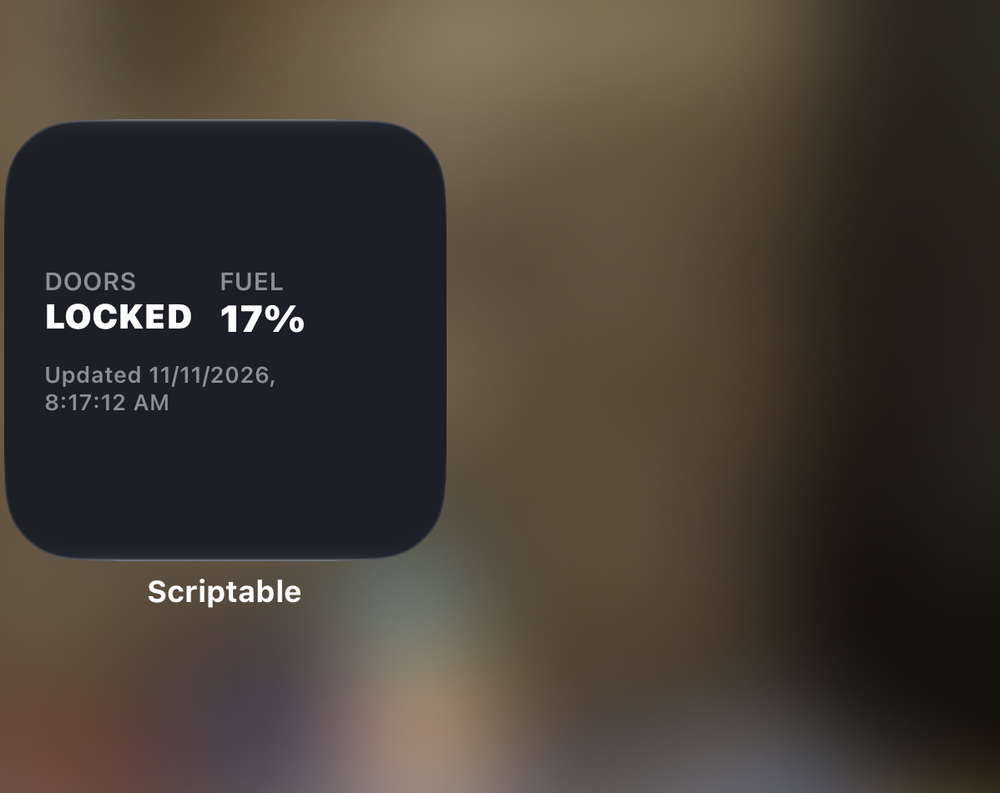
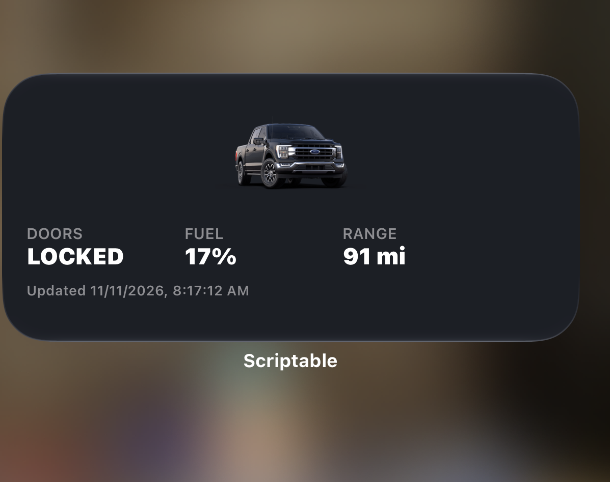
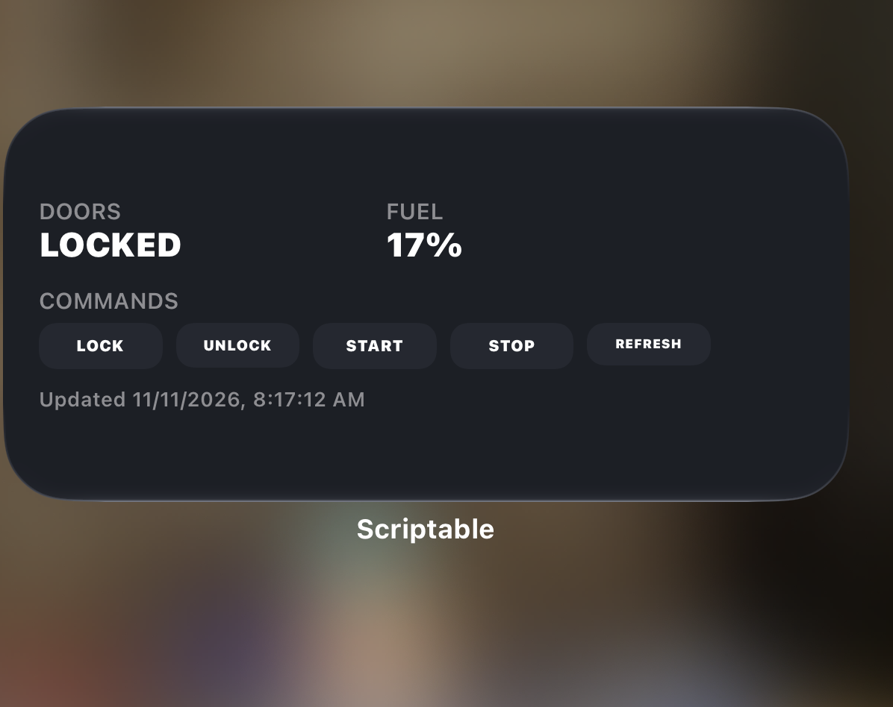
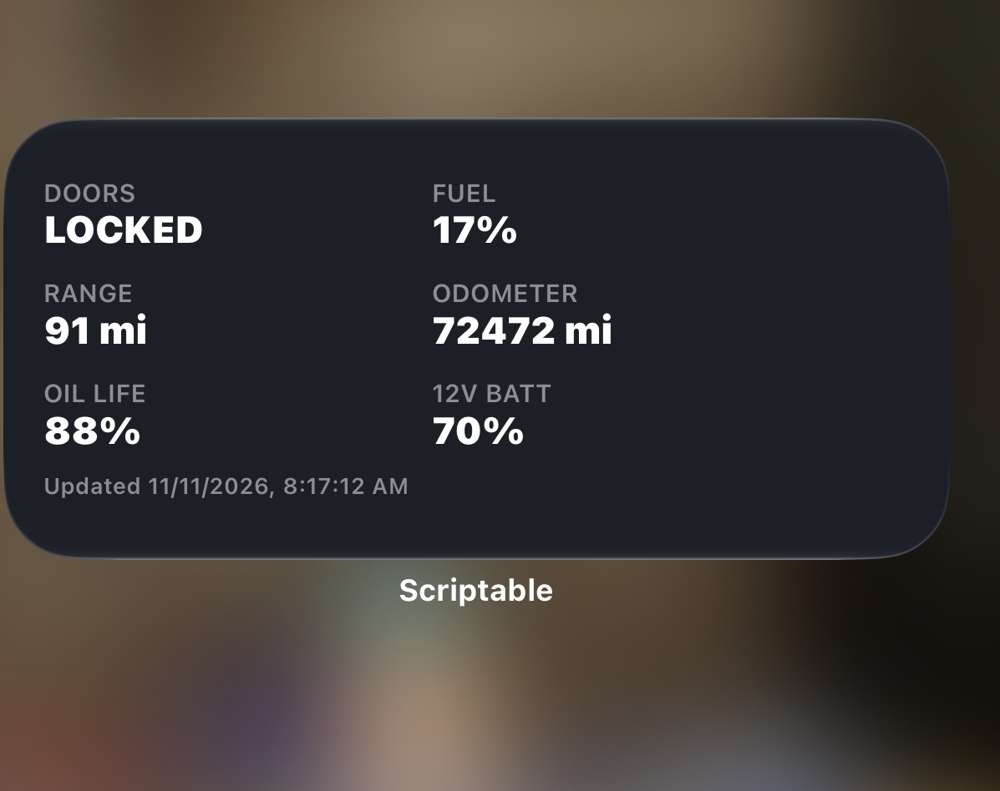
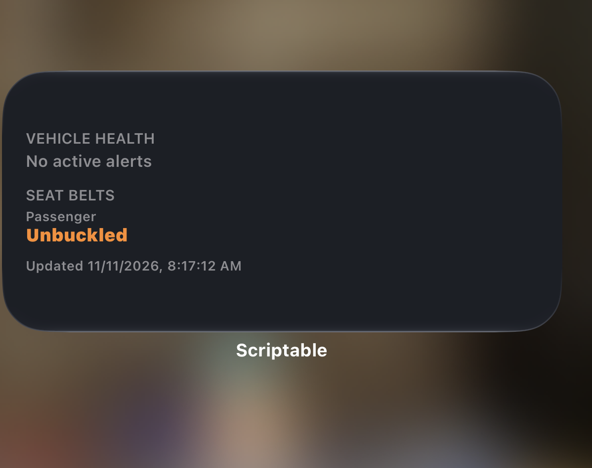
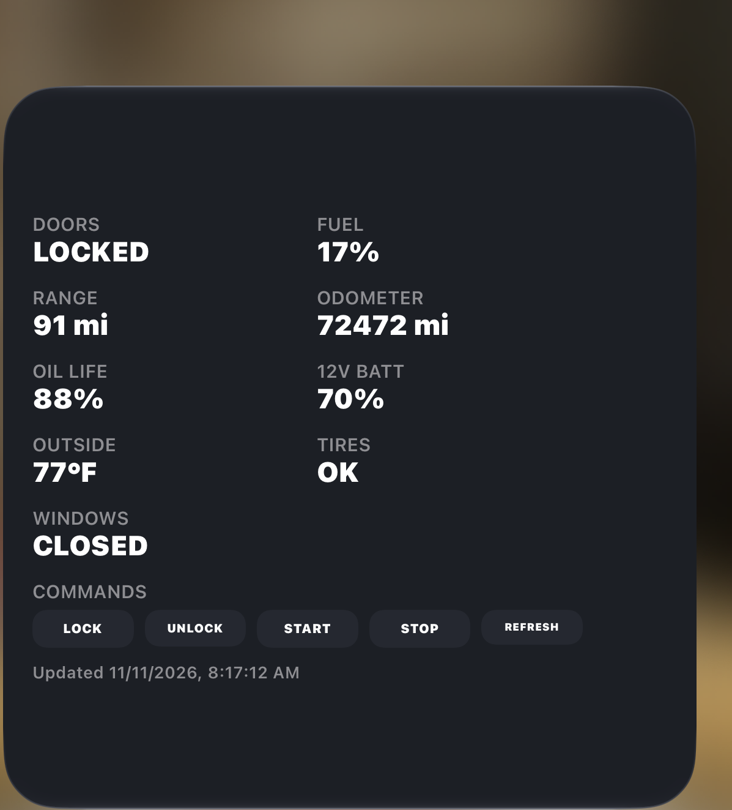
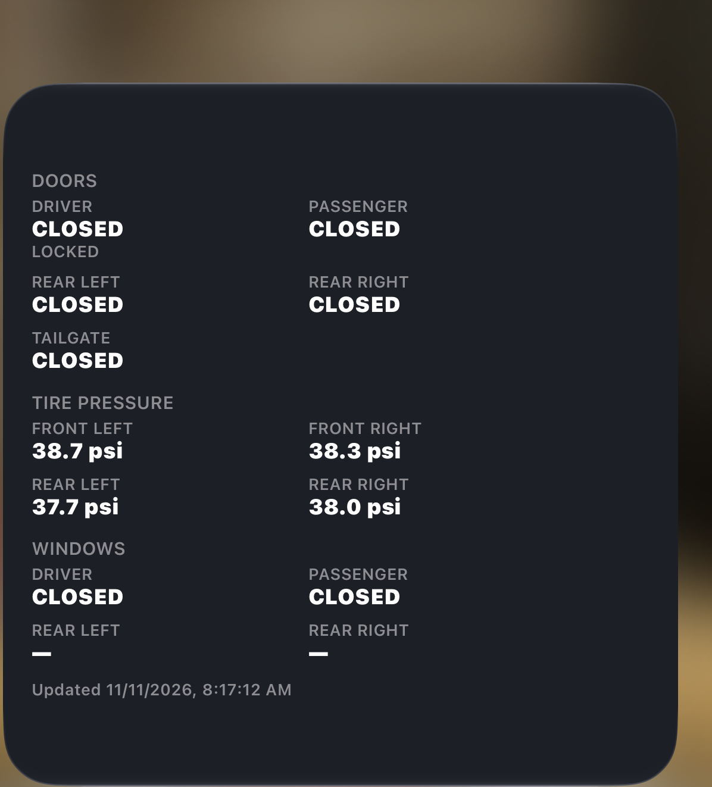

# scriptable-fordpass

A Ford/Lincoln vehicle widget for [Scriptable](https://scriptable.app) (iOS). Single file, no
account of ours, no server — it talks straight to Ford's own app API from your phone.

**[→ Setup &amp; widget configurator](https://dynacylabs.github.io/scriptable-fordpass/)** —
install with copy/paste buttons and build your widget's layout visually.

## Screenshots

<table>
<tr>
<td width="33%"> Small — <code>doors,fuel</code></td>
<td width="33%"> Medium — <code>image,doors,fuel,range</code></td>
<td width="33%"> Medium — <code>doors,fuel,commands</code></td>
</tr>
<tr>
<td width="33%"> Medium — <code>doors,fuel,range,odometer,oil,battery12v</code></td>
<td width="33%"> Medium — <code>healthVerbose,seatBeltVerbose</code></td>
<td width="33%"> Large — full dashboard + commands</td>
</tr>
</table>

 
Large — <code>doorsVerbose,tiresVerbose,windowsVerbose</code>

## What it does

Talks to the same private FordPass/Lincoln Way mobile-app API the official app uses
(reverse-engineered, ported from [ha-fordpass](https://github.com/marq24/ha-fordpass)). That
gets you both reads (doors, fuel/charge, range, odometer, outside temp, oil life/12V battery,
tires, windows, health, and more) and writes (lock, unlock, remote start) — the official,
supported FordConnect Query API is read-only and can't do the last part.

This is unofficial and unsupported by Ford: it can break without notice, and there have been
reports of accounts drawing scrutiny for third-party API use — consider a secondary FordPass
account rather than your primary one.

## Why no server

Ford's hosted sign-in page finishes by redirecting to a mobile-app deep link, not a web page —
normally why tools like this need a companion website and a manual copy-paste out of devtools.
Scriptable's `WebView` can inspect that redirect directly, so the whole sign-in happens on-device
in a real Ford web page you sign into yourself: this script never sees your Ford password, the
resulting tokens are encrypted in Scriptable's `Keychain`, and nothing of yours is ever sent
anywhere except straight to Ford's and Autonomic's own endpoints. There's also no client *secret*
to protect here — the IDs this script hardcodes are public identifiers baked into Ford's own
FordPass app binary, not something you register.

iOS Keychain data survives deleting and reinstalling an app, by design — so a device that's been
reset, resold, or handed to someone else could still have a previous owner's sign-in token and
vehicle sitting in Keychain. The script detects this (the first time it runs after a fresh install
of the script itself) and clears any leftover account data before doing anything else, rather than
silently handing a new phone owner control over a vehicle that isn't theirs.

## Setup

The [setup page](https://dynacylabs.github.io/scriptable-fordpass/) has copy/paste buttons and
screenshots. The short version:

1. Install [Scriptable](https://apps.apple.com/app/scriptable/id1405459188) from the App Store.
2. Add `FordPass.js` as a new script (paste its contents, or import from URL via Scriptable's "+"
   menu), and rename it from "Untitled Script" to `FordPass` — Scriptable has no way to set this
   automatically when pasting.
3. Run the script once — don't add it as a widget yet. It'll ask for your region (leave as `usa`
   unless you're outside North America), then open a sign-in window. Sign in with your real Ford
   account. Once signed in, it fetches your account's vehicles and lets you pick which to add —
   no VIN typing.
4. Once it says "Connected", add a Scriptable widget to your home screen pointing at this script.

Run the script again later (instead of just viewing the widget) to open its menu: **View status**
(read-only), **Commands** (lock/unlock/remote start/etc.), **Configure widget (basic/advanced)**,
**Manage vehicles**, **Re-run setup**.

## Multiple vehicles

Add as many vehicles as your Ford account has: run the script → **Manage vehicles** → tap a
vehicle to add it, or tap an already-added one to set it **active** (what the menu, and any
widget without a vehicle pinned, operates on). Each widget can show a *different* vehicle — the
configurator's "Copy as Parameter text" picks one for you, or add the VIN itself as a bare token
to a Parameter field by hand. Command buttons on a widget always act on whichever vehicle that
widget is showing, regardless of which one is account-active. A single prior vehicle migrates
into this automatically, no action needed.

## Write commands

Lock, unlock, remote start, cancel remote start, and request a fresh report. Two ways to send
one:

- **In-script menu → Commands** — run the script, tap Commands, pick one.
- **`commands` widget block** (medium/large widgets, opt-in) — buttons directly on the widget.
  Tapping one opens the app to a confirm dialog before anything sends, so a stray tap can't fire
  a command by itself.

Commands are fire-and-forget — Ford confirms receipt, not that the vehicle executed it; re-check
a few seconds later to see it take effect. **Cancel remote start specifically has no confirmed
success path** — Ford's own command-status endpoint never resolved it past "queued" in testing,
so the widget says as much rather than claiming success it can't back up.

After a `commands` button sends, no third-party app (Scriptable included) is allowed to return
you to the home screen on its own — Apple doesn't expose that API. You can work around it with a
Shortcut:

1. Shortcuts app → **+** → Add Action → search **"Go to Home Screen"** → add it (only action).
2. Rename the shortcut to exactly **`Go Home`**.
3. Run the script → **Configure widget** → **`"Go Home" after widget commands`** → confirm → On.

Until that's set up, commands still send fine — you'll just land wherever Scriptable normally
leaves you. Use a different shortcut name by editing `GO_HOME_SHORTCUT_NAME` near the top of
`runCommandFromWidget()` in the script.

## Configuring a widget

Each widget instance can show a different set of tiles, via its Parameter field (long-press the
widget → Edit Widget → Parameter) — a comma-separated list of item names plus modifiers, e.g.
`doors,fuel,odometer,metric`. Build one visually with the
[web configurator](https://dynacylabs.github.io/scriptable-fordpass/#configure) or the in-script
menu (**Configure widget (basic)**/**(advanced)**) — pick items, reorder with ↑/↓, set
units/columns/title/maps, then **save as default** (applies to any widget with a blank
Parameter field) or **copy as Parameter text** for one specific widget. **Advanced** adds
driving-only telemetry (speed, pedals, RPM, trip stats, etc.) and a few unconfirmed raw signals
on top of everything **Basic** offers — see [DEVELOPMENT.md](DEVELOPMENT.md) for what's
confirmed vs. assumed about those.

### Parameter field reference

A widget's Parameter field is a single text field, used as a comma-separated list — order
controls display order:

- **Tiles** (3 per row by default): `doors`, `fuel` (fuel level or EV charge %), `range`,
  `odometer`, `outside` (outside temp), `oil` (oil life, ICE only), `battery12v`, `tires`,
  `windows`, `alarm`, `panicAlarm`, `ignition`, `health`, `hood`, `parkingBrake`,
  `remoteStartTimer`, `seatBelt`, `imageTile` (vehicle photo, tile-sized). Opt-in/advanced:
  `ambientTemp`, `xevPlugCharger`, `speed`, `accelPedal`, `brakePedal`, `brakeTorque`,
  `engineSpeed`, `engineCoolantTemp`, `gear`, `transTorque`, `wheelTorque`, `yawRate`,
  `tripEconomy`, `tripEvDistance`, `acceleration`.
- **Full-width blocks** (always their own row): `doorsVerbose`, `tiresVerbose`,
  `windowsVerbose`, `healthVerbose`, `seatBeltVerbose` (per-item detail grids/lists),
  `accelerationVerbose`, `customMetricsVerbose`, `location` (tappable map link),
  `commands` (lock/unlock/start/stop/refresh buttons), `image` (full-width vehicle photo).
- **Modifiers**: `imperial`/`metric` (override the saved unit preference for this widget),
  `notitle` (hide the "FordPass" header), `applemaps`/`googlemaps` (pin the `location` link),
  `cols2`/`cols3`/`cols4` (tiles per row, default 3), `newrow` (force a row break at that point,
  repeatable), a vehicle's VIN (pin this widget to one vehicle — see Multiple vehicles above).

Example: `doorsVerbose,fuel,odometer,metric,notitle` — door table, then fuel + odometer on their
own row, metric, no header. Leave blank for the saved default, or the built-in default if you've
never opened a configurator (small widgets: doors + fuel; medium/large: all core tiles). An
unrecognized token is silently ignored, so a typo falls back to the default instead of breaking
the widget.

## Units

Ford's API always reports metric (km, °C, kPa) regardless of your vehicle's region. The script
converts to imperial (mi, °F, psi) by default; switch from the in-script menu — saved and applied
everywhere unless overridden per-widget as above. Fuel level, EV charge, oil life, and 12V
battery are already percentages, so no conversion applies to those.

## Roadmap

Not promises, just the direction this is headed:

- **Lock Screen widgets** — support for the circular/rectangular/inline Lock Screen widget
  families, not just Home Screen widgets.

## License &amp; support

Licensed under [CC BY-NC-SA 4.0](LICENSE): noncommercial use, attribution required, forks must
share-alike. See [LICENSE](LICENSE) for the full terms.

This widget is free and will stay that way. If it's useful to you,
[sponsoring the project](https://github.com/sponsors/dynacylabs) helps justify the time spent
keeping it working as Ford changes their API out from under it.

---

Implementation-verification details and the UI layout-fix history live in
[DEVELOPMENT.md](DEVELOPMENT.md), kept separate so this README stays focused on using the widget.
